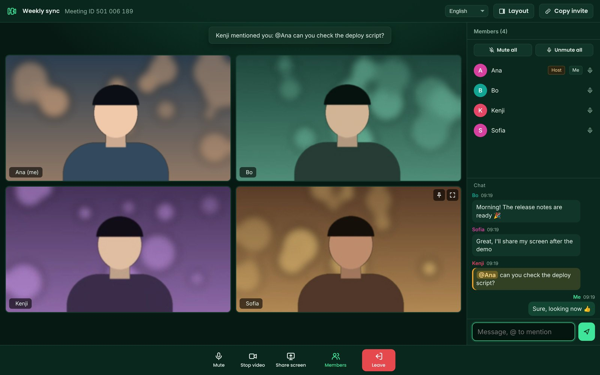
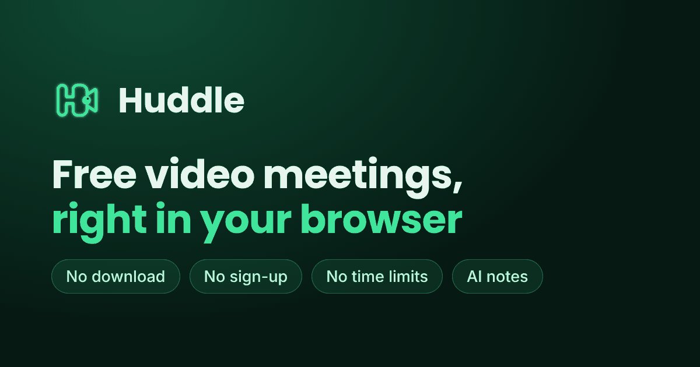

**English** · [Español](docs/i18n/README.es.md) · [Français](docs/i18n/README.fr.md) · [Português](docs/i18n/README.pt.md) · [Deutsch](docs/i18n/README.de.md) · [Русский](docs/i18n/README.ru.md) · [Українська](docs/i18n/README.uk.md) · [العربية](docs/i18n/README.ar.md) · [فارسی](docs/i18n/README.fa.md) · [日本語](docs/i18n/README.ja.md) · [한국어](docs/i18n/README.ko.md) · [简体中文](docs/i18n/README.zh-CN.md) · [繁體中文](docs/i18n/README.zh-TW.md)

# Hudd

<p align="center">
<a href="LICENSE"></a>
<a href="https://github.com/AldrichWorld/hudd/releases"></a>
<a href="https://github.com/AldrichWorld/hudd/stargazers"></a>


</p>

**Free video meetings that run in the browser.** Nothing to install, no accounts, no time limits, and no database.
Run your own with one command.

<p align="center"></p>

> **Just want to meet?** [hudd.live](https://hudd.live) is the hosted service built on Hudd: nothing to set up, plus extras such as AI meeting notes, virtual backgrounds and screen effects.

<p align="center"><a href="https://hudd.live"></a></p>

## Features

- Video and audio meetings in any modern browser, on computers and phones
- Screen sharing, tuned for sharp text
- Chat in the meeting, with @mentions
- Grid and speaker layouts, pin and full screen
- Meeting passwords
- Host controls: mute everyone, mute one person, ask someone to unmute, end the meeting for everyone
- 13 interface languages: English, Español, Français, Português, Deutsch, Русский, Українська, العربية, فارسی, 日本語, 한국어, 简体中文, 繁體中文
- Installable as an app (PWA) on computers and phones
- Nothing is stored: no database, no accounts, chat messages are never saved

## Quick start

You need [Docker](https://docs.docker.com/get-docker/) with Docker Compose.

```bash
git clone https://github.com/AldrichWorld/hudd.git
cd hudd
./deploy.sh
```

The script asks one question: your domain name.

- **On a server with a domain name:** point the domain's DNS A record at the server, open TCP 80, 443, 7881 and UDP 7882, then type the domain when asked. Hudd gets a free HTTPS certificate and runs at `https://your-domain`.
- **On your own computer or local network:** just press Enter. Hudd runs at `http://localhost:8080`, and other devices on your network can use `https://<this computer's IP>:8443` (self-signed certificate).

Other commands: `./deploy.sh status`, `./deploy.sh logs`, `./deploy.sh restart` (after editing `.env`), `./deploy.sh update`, `./deploy.sh down`.

### Without Docker

You can also build and run Hudd from source: get the code, build the front end, set up a Python environment, and run LiveKit and the web service with systemd behind Caddy or Nginx. The step-by-step guide is in [Install from source](docs/install-from-source.md). To try it on your own computer first:

```bash
git clone https://github.com/AldrichWorld/hudd.git && cd hudd
(cd web/vendor-src && npm ci && sh build.sh ../static/vendor)
python3 -m venv .venv && .venv/bin/pip install -r web/requirements.txt
livekit-server --dev --bind 127.0.0.1 &
cd web && LIVEKIT_PUBLIC_URL=ws://localhost:7880 ../.venv/bin/uvicorn app.main:app --port 8000
```

Then open `http://localhost:8000` (needs Node.js, Python 3.11+ and [livekit-server](https://docs.livekit.io/home/self-hosting/local/)).

## Settings

All settings are in `.env` (created on the first run from `.env.example`). The ones you are most likely to change:

| Setting | What it does |
|---|---|
| `DOMAIN`, `ACME_EMAIL` | Public mode with automatic HTTPS. Leave `DOMAIN` empty for local mode |
| `CREATE_PASSCODE` | Only people who know this passcode can start meetings. Joining with a link never needs it |
| `REVERSE_PROXY=host` | Your own Nginx or Caddy already uses ports 80/443 (see below) |
| `PUBLIC_HOST` | This machine's IP address for media traffic. Detected automatically |
| `ROOM_EMPTY_TIMEOUT` | How long a new meeting waits for its first person (seconds, default 1800) |
| `ROOMS_PER_HOUR_PER_IP`, `OPEN_ROOMS_PER_IP` | Abuse limits per visitor IP (0 = no limit) |
| `APP_NAME`, `SOURCE_URL` | The name shown in the pages, and the source-code link in the footer |

Run `./deploy.sh restart` after changing `.env`.

### Behind your own web server

If Nginx or Caddy on the host already uses ports 80 and 443, set `REVERSE_PROXY=host` in `.env`. Hudd then listens on `127.0.0.1:18080` only, and your web server forwards the domain to it, including WebSockets:

```nginx
location / {
    proxy_pass http://127.0.0.1:18080;
    proxy_http_version 1.1;
    proxy_set_header Upgrade $http_upgrade;
    proxy_set_header Connection "upgrade";
    proxy_set_header Host $host;
    proxy_set_header X-Forwarded-For $proxy_add_x_forwarded_for;
    proxy_set_header X-Forwarded-Proto $scheme;
    proxy_read_timeout 3600s;
}
```

With Caddy it is one line: `your-domain { reverse_proxy 127.0.0.1:18080 }`. Media still needs TCP 7881 and UDP 7882 open.

## How it works

Three containers, started by `docker-compose.yml`:

- **LiveKit** (media server): carries the audio, video and screen sharing.
- **web** (Python, FastAPI): the pages and a small API to create and join meetings.
- **Caddy** HTTPS, and one address for both the pages and LiveKit.

There is no database. A meeting exists exactly as long as its LiveKit room exists; the room's metadata holds the topic, the host's name and a keyed hash of the password. The host's rights come from a signed key, so restarting the web service does not interrupt anything. Chat messages go directly between participants and are never stored.

```
web/app/         main.py (pages + API) · rooms.py (meetings, no database) · lk.py (LiveKit) · i18n.py (server messages)
web/static/      index.html, room.html, js/, css/
web/static/js/i18n.js   all interface text in 13 languages
tests/           end-to-end tests with a real LiveKit server and a headless browser
```

## Development and tests

```bash
pip install -r web/requirements.txt httpx playwright && python -m playwright install chromium
# livekit-server on your PATH: https://docs.livekit.io/home/self-hosting/local/
tests/run_tests.sh
```

## Translations

All interface text is in [`web/static/js/i18n.js`](web/static/js/i18n.js), one block per language. To fix a translation or add a language, edit that file and open a pull request; `tests/test_i18n.py` checks that every language has the same keys and placeholders.

## License

[MIT](LICENSE). Third-party components and their licenses are listed in [THIRD-PARTY-NOTICES](web/static/THIRD-PARTY-NOTICES.txt).

Hudd is the open-source core of [hudd.live](https://hudd.live). Issues and pull requests are welcome.
