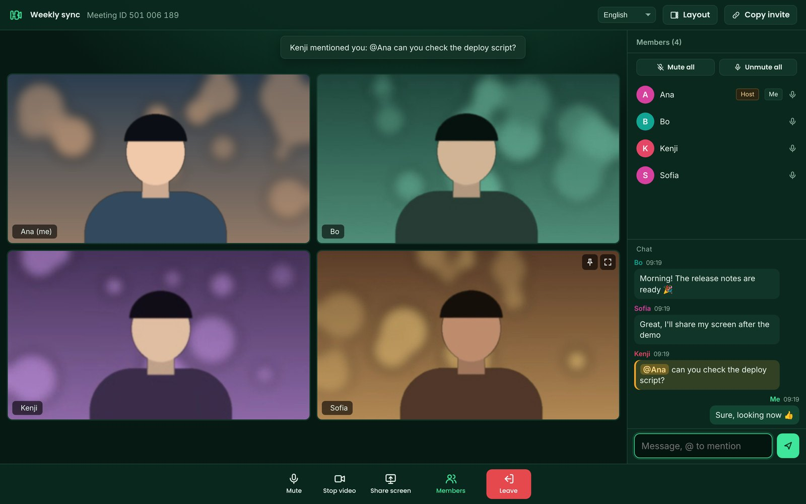
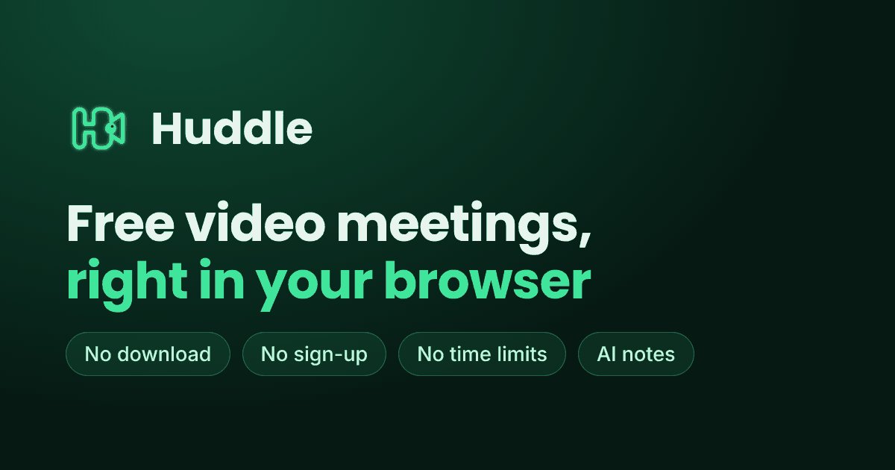

[English](../../README.md) · **Español** · [Français](README.fr.md) · [Português](README.pt.md) · [Deutsch](README.de.md) · [Русский](README.ru.md) · [Українська](README.uk.md) · [العربية](README.ar.md) · [فارسی](README.fa.md) · [日本語](README.ja.md) · [한국어](README.ko.md) · [简体中文](README.zh-CN.md) · [繁體中文](README.zh-TW.md)

# Hudd

<p align="center">
<a href="../../LICENSE"></a>
<a href="https://github.com/AldrichWorld/hudd/releases"></a>
<a href="https://github.com/AldrichWorld/hudd/stargazers"></a>


</p>

**Videollamadas gratuitas que funcionan en el navegador.** Sin instalar nada, sin cuentas, sin límite de tiempo y sin base de datos.
Instala la tuya con un solo comando.

<p align="center"></p>

> **¿Solo quieres reunirte?** [hudd.live](https://hudd.live) es el servicio alojado basado en Hudd: no hay nada que configurar y añade extras como notas de reunión con IA, fondos virtuales y efectos en pantalla.

<p align="center"><a href="https://hudd.live"></a></p>

## Funciones

- Reuniones de audio y vídeo en cualquier navegador moderno, en ordenadores y móviles
- Pantalla compartida, ajustada para que el texto se lea bien
- Chat en la reunión, con @menciones
- Vistas de cuadrícula y de orador, fijar y pantalla completa
- Contraseñas de reunión
- Controles del anfitrión: silenciar a todos, silenciar a una persona, pedir a alguien que active el micrófono, terminar la reunión para todos
- 13 idiomas de interfaz: English, Español, Français, Português, Deutsch, Русский, Українська, العربية, فارسی, 日本語, 한국어, 简体中文, 繁體中文
- Se puede instalar como aplicación (PWA) en ordenadores y móviles
- No se guarda nada: ni base de datos, ni cuentas; los mensajes del chat nunca se almacenan

## Inicio rápido

Necesitas [Docker](https://docs.docker.com/get-docker/) con Docker Compose.

```bash
git clone https://github.com/AldrichWorld/hudd.git
cd hudd
./deploy.sh
```

El script solo hace una pregunta: tu nombre de dominio.

- **En un servidor con dominio:** apunta el registro DNS A del dominio al servidor, abre TCP 80, 443, 7881 y UDP 7882, y escribe el dominio cuando te lo pida. Hudd obtiene un certificado HTTPS gratuito y funciona en `https://tu-dominio`.
- **En tu propio ordenador o red local:** pulsa Enter. Hudd funciona en `http://localhost:8080`, y otros dispositivos de tu red pueden usar `https://<IP de este ordenador>:8443` (certificado autofirmado).

Otros comandos: `./deploy.sh status`, `./deploy.sh logs`, `./deploy.sh restart` (tras editar `.env`), `./deploy.sh update`, `./deploy.sh down`.

### Sin Docker

También puedes compilar y ejecutar Hudd desde el código fuente: descarga el código, compila el front-end, prepara un entorno de Python y ejecuta LiveKit y el servicio web con systemd detrás de Caddy o Nginx. La guía paso a paso (en inglés) está en [Instalar desde el código fuente](../../docs/install-from-source.md). Para probarlo antes en tu ordenador:

```bash
git clone https://github.com/AldrichWorld/hudd.git && cd hudd
(cd web/vendor-src && npm ci && sh build.sh ../static/vendor)
python3 -m venv .venv && .venv/bin/pip install -r web/requirements.txt
livekit-server --dev --bind 127.0.0.1 &
cd web && LIVEKIT_PUBLIC_URL=ws://localhost:7880 ../.venv/bin/uvicorn app.main:app --port 8000
```

Después abre `http://localhost:8000` (necesitas Node.js, Python 3.11+ y [livekit-server](https://docs.livekit.io/home/self-hosting/local/)).

## Configuración

Toda la configuración está en `.env` (se crea en la primera ejecución a partir de `.env.example`). Las opciones que más se cambian:

| Opción | Para qué sirve |
|---|---|
| `DOMAIN`, `ACME_EMAIL` | Modo público con HTTPS automático. Deja `DOMAIN` vacío para el modo local |
| `CREATE_PASSCODE` | Solo quien conozca este código puede iniciar reuniones. Para unirse con un enlace nunca hace falta |
| `REVERSE_PROXY=host` | Tu Nginx o Caddy ya usa los puertos 80/443 (ver abajo) |
| `PUBLIC_HOST` | La IP de esta máquina para el tráfico de audio y vídeo. Se detecta automáticamente |
| `ROOM_EMPTY_TIMEOUT` | Cuánto espera una reunión nueva a la primera persona (segundos, 1800 por defecto) |
| `ROOMS_PER_HOUR_PER_IP`, `OPEN_ROOMS_PER_IP` | Límites contra el abuso por IP de visitante (0 = sin límite) |
| `APP_NAME`, `SOURCE_URL` | El nombre que se muestra en las páginas y el enlace al código fuente en el pie |

Ejecuta `./deploy.sh restart` después de cambiar `.env`.

### Detrás de tu propio servidor web

Si Nginx o Caddy en el servidor ya usa los puertos 80 y 443, pon `REVERSE_PROXY=host` en `.env`. Hudd escuchará solo en `127.0.0.1:18080` y tu servidor web le reenviará el dominio, incluidos los WebSockets:

```nginx
location / {
    proxy_pass http://127.0.0.1:18080;
    proxy_http_version 1.1;
    proxy_set_header Upgrade $http_upgrade;
    proxy_set_header Connection "upgrade";
    proxy_set_header Host $host;
    proxy_set_header X-Forwarded-For $proxy_add_x_forwarded_for;
    proxy_set_header X-Forwarded-Proto $scheme;
    proxy_read_timeout 3600s;
}
```

Con Caddy es una línea: `tu-dominio { reverse_proxy 127.0.0.1:18080 }`. El audio y el vídeo siguen necesitando TCP 7881 y UDP 7882 abiertos.

## Cómo funciona

`docker-compose.yml` arranca tres contenedores:

- **LiveKit** (servidor de medios): transporta el audio, el vídeo y la pantalla compartida.
- **web** (Python, FastAPI): las páginas y una pequeña API para crear reuniones y unirse a ellas.
- **Caddy** HTTPS y una sola dirección para las páginas y LiveKit.

No hay base de datos. Una reunión existe exactamente mientras exista su sala de LiveKit; los datos de la sala guardan el tema, el nombre del anfitrión y un hash con clave de la contraseña. Los permisos del anfitrión vienen de una clave firmada, así que reiniciar el servicio web no interrumpe nada. Los mensajes del chat van directamente entre participantes y nunca se guardan.

```
web/app/         main.py (pages + API) · rooms.py (meetings, no database) · lk.py (LiveKit) · i18n.py (server messages)
web/static/      index.html, room.html, js/, css/
web/static/js/i18n.js   all interface text in 13 languages
tests/           end-to-end tests with a real LiveKit server and a headless browser
```

## Desarrollo y pruebas

```bash
pip install -r web/requirements.txt httpx playwright && python -m playwright install chromium
# livekit-server on your PATH: https://docs.livekit.io/home/self-hosting/local/
tests/run_tests.sh
```

## Traducciones

Todo el texto de la interfaz está en [`web/static/js/i18n.js`](../../web/static/js/i18n.js), un bloque por idioma. Para corregir una traducción o añadir un idioma, edita ese archivo y abre un pull request; `tests/test_i18n.py` comprueba que todos los idiomas tengan las mismas claves y marcadores.

## Licencia

[MIT](../../LICENSE). Los componentes de terceros y sus licencias figuran en [THIRD-PARTY-NOTICES](../../web/static/THIRD-PARTY-NOTICES.txt).

Hudd es el núcleo de código abierto de [hudd.live](https://hudd.live). Las incidencias y los pull requests son bienvenidos.
