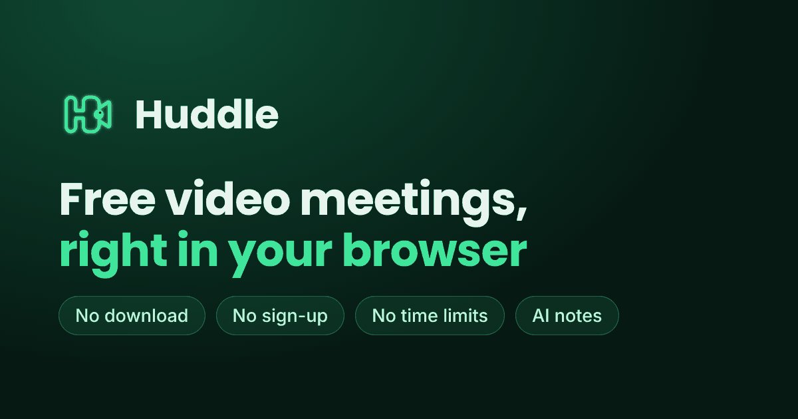

<div dir="rtl">

[English](../../README.md) · [Español](README.es.md) · [Français](README.fr.md) · [Português](README.pt.md) · [Deutsch](README.de.md) · [Русский](README.ru.md) · [Українська](README.uk.md) · [العربية](README.ar.md) · **فارسی** · [日本語](README.ja.md) · [한국어](README.ko.md) · [简体中文](README.zh-CN.md) · [繁體中文](README.zh-TW.md)

# Hudd

**جلسه‌های ویدیویی رایگان که در مرورگر اجرا می‌شوند.** بدون نصب، بدون حساب کاربری، بدون محدودیت زمانی و بدون پایگاه داده.
نسخهٔ خودتان را با یک فرمان راه‌اندازی کنید.

> **فقط می‌خواهید جلسه بگذارید؟** [hudd.live](https://hudd.live) سرویس میزبانی‌شده‌ای است که بر پایهٔ Hudd ساخته شده: نیازی به راه‌اندازی نیست و امکاناتی مثل یادداشت‌های جلسه با هوش مصنوعی، پس‌زمینهٔ مجازی و جلوه‌های صفحه هم دارد.

<p align="center"><a href="https://hudd.live"></a></p>

## امکانات

- جلسهٔ صوتی و تصویری در هر مرورگر به‌روز، روی رایانه و تلفن همراه
- اشتراک‌گذاری صفحه با تنظیماتی برای خوانایی متن
- گفتگو در جلسه، با اشاره با @
- نمای شبکه‌ای و نمای سخنران، سنجاق کردن و تمام‌صفحه
- گذرواژه برای جلسه
- کنترل‌های میزبان: بی‌صدا کردن همه، بی‌صدا کردن یک نفر، درخواست روشن کردن میکروفون، پایان جلسه برای همه
- ۱۳ زبان برای رابط کاربری: English, Español, Français, Português, Deutsch, Русский, Українська, العربية, فارسی, 日本語, 한국어, 简体中文, 繁體中文
- قابل نصب به‌عنوان برنامه (PWA) روی رایانه و تلفن همراه
- هیچ چیزی ذخیره نمی‌شود: نه پایگاه داده، نه حساب کاربری؛ پیام‌های گفتگو هرگز ذخیره نمی‌شوند

## شروع سریع

به [Docker](https://docs.docker.com/get-docker/) همراه با Docker Compose نیاز دارید.

```bash
git clone https://github.com/AldrichWorld/hudd.git
cd hudd
./deploy.sh
```

اسکریپت فقط یک سؤال می‌پرسد: نام دامنهٔ شما.

- **روی سروری با دامنه:** رکورد DNS از نوع A دامنه را به سرور اشاره دهید، درگاه‌های TCP 80، 443، 7881 و UDP 7882 را باز کنید و هنگام پرسش، دامنه را وارد کنید. Hudd یک گواهی HTTPS رایگان می‌گیرد و در `https://دامنه-شما` اجرا می‌شود.
- **روی رایانهٔ خودتان یا شبکهٔ محلی:** فقط Enter را بزنید. Hudd در `http://localhost:8080` اجرا می‌شود و دستگاه‌های دیگر شبکه می‌توانند از `https://<IP این رایانه>:8443` استفاده کنند (گواهی خودامضا).

فرمان‌های دیگر: `./deploy.sh status`، `./deploy.sh logs`، `./deploy.sh restart` (پس از ویرایش `.env`)، `./deploy.sh update`، `./deploy.sh down`.

### بدون Docker

می‌توانید Hudd را از کد منبع هم بسازید و اجرا کنید: کد را بگیرید، بخش رابط را بسازید، یک محیط Python آماده کنید و LiveKit و سرویس وب را با systemd پشت Caddy یا Nginx اجرا کنید. راهنمای گام‌به‌گام (به انگلیسی) در [نصب از کد منبع](../../docs/install-from-source.md) است. برای اینکه اول روی رایانهٔ خودتان امتحان کنید:

```bash
git clone https://github.com/AldrichWorld/hudd.git && cd hudd
(cd web/vendor-src && npm ci && sh build.sh ../static/vendor)
python3 -m venv .venv && .venv/bin/pip install -r web/requirements.txt
livekit-server --dev --bind 127.0.0.1 &
cd web && LIVEKIT_PUBLIC_URL=ws://localhost:7880 ../.venv/bin/uvicorn app.main:app --port 8000
```

سپس `http://localhost:8000` را باز کنید (به Node.js، Python 3.11+ و [livekit-server](https://docs.livekit.io/home/self-hosting/local/) نیاز دارد).

## تنظیمات

همهٔ تنظیمات در `.env` است (در اولین اجرا از روی `.env.example` ساخته می‌شود). مواردی که بیشتر تغییر می‌کنند:

| تنظیم | کاربرد |
|---|---|
| `DOMAIN`, `ACME_EMAIL` | حالت عمومی با HTTPS خودکار. برای حالت محلی `DOMAIN` را خالی بگذارید |
| `CREATE_PASSCODE` | فقط کسانی که این رمز را می‌دانند می‌توانند جلسه شروع کنند. پیوستن با پیوند هرگز به آن نیاز ندارد |
| `REVERSE_PROXY=host` | Nginx یا Caddy شما از قبل از درگاه‌های 80/443 استفاده می‌کند (پایین را ببینید) |
| `PUBLIC_HOST` | نشانی IP این دستگاه برای انتقال صدا و تصویر. به‌طور خودکار تشخیص داده می‌شود |
| `ROOM_EMPTY_TIMEOUT` | مدتی که جلسهٔ تازه منتظر اولین نفر می‌ماند (ثانیه، پیش‌فرض 1800) |
| `ROOMS_PER_HOUR_PER_IP`, `OPEN_ROOMS_PER_IP` | محدودیت‌های ضدسوءاستفاده برای هر IP بازدیدکننده (0 = بدون محدودیت) |
| `APP_NAME`, `SOURCE_URL` | نامی که در صفحه‌ها نمایش داده می‌شود و پیوند کد منبع در پانویس |

پس از تغییر `.env`، فرمان `./deploy.sh restart` را اجرا کنید.

### پشت وب‌سرور خودتان

اگر Nginx یا Caddy روی سرور از قبل درگاه‌های 80 و 443 را اشغال کرده است، در `.env` مقدار `REVERSE_PROXY=host` را تنظیم کنید. آن‌گاه Hudd فقط روی `127.0.0.1:18080` گوش می‌دهد و وب‌سرور شما دامنه را، همراه با WebSocket، به آن هدایت می‌کند:

```nginx
location / {
    proxy_pass http://127.0.0.1:18080;
    proxy_http_version 1.1;
    proxy_set_header Upgrade $http_upgrade;
    proxy_set_header Connection "upgrade";
    proxy_set_header Host $host;
    proxy_set_header X-Forwarded-For $proxy_add_x_forwarded_for;
    proxy_set_header X-Forwarded-Proto $scheme;
    proxy_read_timeout 3600s;
}
```

با Caddy فقط یک خط است: `دامنه-شما { reverse_proxy 127.0.0.1:18080 }`. صدا و تصویر همچنان به باز بودن TCP 7881 و UDP 7882 نیاز دارند.

## چطور کار می‌کند

`docker-compose.yml` سه کانتینر را اجرا می‌کند:

- **LiveKit** (سرور رسانه): صدا، تصویر و اشتراک‌گذاری صفحه را منتقل می‌کند.
- **web** (Python و FastAPI): صفحه‌ها و یک API کوچک برای ساختن جلسه و پیوستن به آن.
- **Caddy** HTTPS و یک نشانی واحد برای صفحه‌ها و LiveKit.

پایگاه داده‌ای وجود ندارد. هر جلسه دقیقاً تا زمانی وجود دارد که اتاقش در LiveKit وجود دارد؛ داده‌های اتاق موضوع، نام میزبان و درهم‌سازی کلیددار گذرواژه را نگه می‌دارند. اختیارات میزبان از یک کلید امضاشده می‌آید، پس راه‌اندازی دوبارهٔ سرویس وب چیزی را قطع نمی‌کند. پیام‌های گفتگو مستقیماً بین شرکت‌کنندگان رد و بدل می‌شوند و هرگز ذخیره نمی‌شوند.

```
web/app/         main.py (pages + API) · rooms.py (meetings, no database) · lk.py (LiveKit) · i18n.py (server messages)
web/static/      index.html, room.html, js/, css/
web/static/js/i18n.js   all interface text in 13 languages
tests/           end-to-end tests with a real LiveKit server and a headless browser
```

## توسعه و آزمون

```bash
pip install -r web/requirements.txt httpx playwright && python -m playwright install chromium
# livekit-server on your PATH: https://docs.livekit.io/home/self-hosting/local/
tests/run_tests.sh
```

## ترجمه‌ها

همهٔ متن‌های رابط کاربری در [`web/static/js/i18n.js`](../../web/static/js/i18n.js) است، برای هر زبان یک بخش. برای اصلاح ترجمه یا افزودن زبان، همین فایل را ویرایش کنید و یک pull request باز کنید؛ `tests/test_i18n.py` بررسی می‌کند که همهٔ زبان‌ها کلیدها و جای‌نگهدارهای یکسانی داشته باشند.

## مجوز

[MIT](../../LICENSE). اجزای شخص ثالث و مجوزهایشان در [THIRD-PARTY-NOTICES](../../web/static/THIRD-PARTY-NOTICES.txt) آمده است.

Hudd هستهٔ متن‌باز [hudd.live](https://hudd.live) است. از گزارش مشکل و pull request استقبال می‌کنیم.

</div>
