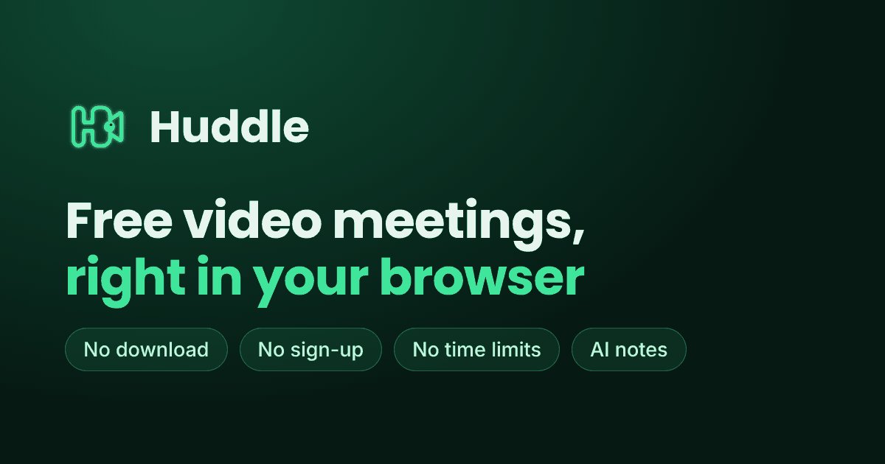

[English](../../README.md) · [Español](README.es.md) · **Français** · [Português](README.pt.md) · [Deutsch](README.de.md) · [Русский](README.ru.md) · [Українська](README.uk.md) · [العربية](README.ar.md) · [فارسی](README.fa.md) · [日本語](README.ja.md) · [한국어](README.ko.md) · [简体中文](README.zh-CN.md) · [繁體中文](README.zh-TW.md)

# Hudd

**Des réunions vidéo gratuites, directement dans le navigateur.** Rien à installer, aucun compte, aucune limite de durée et aucune base de données.
Installez la vôtre en une seule commande.

> **Vous voulez simplement vous réunir ?** [hudd.live](https://hudd.live) est le service hébergé construit sur Hudd : rien à installer, avec en plus des notes de réunion par IA, des arrière-plans virtuels et des effets à l’écran.

<p align="center"><a href="https://hudd.live"></a></p>

## Fonctionnalités

- Réunions audio et vidéo dans tout navigateur récent, sur ordinateur comme sur téléphone
- Partage d’écran réglé pour un texte bien net
- Chat pendant la réunion, avec @mentions
- Vues mosaïque et intervenant, épinglage et plein écran
- Mots de passe de réunion
- Contrôles de l’organisateur : couper tous les micros, couper le micro d’une personne, demander à quelqu’un de réactiver son micro, terminer la réunion pour tous
- 13 langues d’interface: English, Español, Français, Português, Deutsch, Русский, Українська, العربية, فارسی, 日本語, 한국어, 简体中文, 繁體中文
- Installable comme une application (PWA) sur ordinateur et téléphone
- Rien n’est conservé : ni base de données, ni comptes, et les messages du chat ne sont jamais enregistrés

## Démarrage rapide

Il vous faut [Docker](https://docs.docker.com/get-docker/) avec Docker Compose.

```bash
git clone https://github.com/AldrichWorld/hudd.git
cd hudd
./deploy.sh
```

Le script ne pose qu’une question : votre nom de domaine.

- **Sur un serveur avec un nom de domaine :** faites pointer l’enregistrement DNS A du domaine vers le serveur, ouvrez TCP 80, 443, 7881 et UDP 7882, puis saisissez le domaine quand il vous est demandé. Hudd obtient un certificat HTTPS gratuit et tourne sur `https://votre-domaine`.
- **Sur votre ordinateur ou votre réseau local :** appuyez simplement sur Entrée. Hudd tourne sur `http://localhost:8080`, et les autres appareils du réseau peuvent utiliser `https://<IP de cet ordinateur>:8443` (certificat auto-signé).

Autres commandes : `./deploy.sh status`, `./deploy.sh logs`, `./deploy.sh restart` (après avoir modifié `.env`), `./deploy.sh update`, `./deploy.sh down`.

### Sans Docker

Vous pouvez aussi compiler et lancer Hudd depuis les sources : récupérer le code, compiler le front-end, créer un environnement Python, puis lancer LiveKit et le service web avec systemd derrière Caddy ou Nginx. Le guide pas à pas (en anglais) se trouve dans [Installer depuis les sources](../../docs/install-from-source.md). Pour l’essayer d’abord sur votre ordinateur :

```bash
git clone https://github.com/AldrichWorld/hudd.git && cd hudd
(cd web/vendor-src && npm ci && sh build.sh ../static/vendor)
python3 -m venv .venv && .venv/bin/pip install -r web/requirements.txt
livekit-server --dev --bind 127.0.0.1 &
cd web && LIVEKIT_PUBLIC_URL=ws://localhost:7880 ../.venv/bin/uvicorn app.main:app --port 8000
```

Ouvrez ensuite `http://localhost:8000` (il faut Node.js, Python 3.11+ et [livekit-server](https://docs.livekit.io/home/self-hosting/local/)).

## Réglages

Tous les réglages sont dans `.env` (créé au premier lancement à partir de `.env.example`). Ceux que l’on change le plus souvent :

| Réglage | Rôle |
|---|---|
| `DOMAIN`, `ACME_EMAIL` | Mode public avec HTTPS automatique. Laissez `DOMAIN` vide pour le mode local |
| `CREATE_PASSCODE` | Seules les personnes qui connaissent ce code peuvent lancer des réunions. Rejoindre avec un lien n’en a jamais besoin |
| `REVERSE_PROXY=host` | Votre Nginx ou Caddy utilise déjà les ports 80/443 (voir plus bas) |
| `PUBLIC_HOST` | L’adresse IP de cette machine pour l’audio et la vidéo. Détectée automatiquement |
| `ROOM_EMPTY_TIMEOUT` | Durée pendant laquelle une nouvelle réunion attend la première personne (secondes, 1800 par défaut) |
| `ROOMS_PER_HOUR_PER_IP`, `OPEN_ROOMS_PER_IP` | Limites anti-abus par IP de visiteur (0 = aucune limite) |
| `APP_NAME`, `SOURCE_URL` | Le nom affiché dans les pages et le lien vers le code source en pied de page |

Lancez `./deploy.sh restart` après avoir modifié `.env`.

### Derrière votre propre serveur web

Si Nginx ou Caddy utilise déjà les ports 80 et 443 sur la machine, mettez `REVERSE_PROXY=host` dans `.env`. Hudd n’écoute alors que sur `127.0.0.1:18080`, et votre serveur web lui transmet le domaine, WebSockets compris :

```nginx
location / {
    proxy_pass http://127.0.0.1:18080;
    proxy_http_version 1.1;
    proxy_set_header Upgrade $http_upgrade;
    proxy_set_header Connection "upgrade";
    proxy_set_header Host $host;
    proxy_set_header X-Forwarded-For $proxy_add_x_forwarded_for;
    proxy_set_header X-Forwarded-Proto $scheme;
    proxy_read_timeout 3600s;
}
```

Avec Caddy, une seule ligne suffit : `votre-domaine { reverse_proxy 127.0.0.1:18080 }`. L’audio et la vidéo ont toujours besoin de TCP 7881 et UDP 7882 ouverts.

## Fonctionnement

`docker-compose.yml` démarre trois conteneurs :

- **LiveKit** (serveur multimédia) : transporte l’audio, la vidéo et le partage d’écran.
- **web** (Python, FastAPI) : les pages et une petite API pour créer et rejoindre des réunions.
- **Caddy** le HTTPS, et une adresse unique pour les pages et LiveKit.

Il n’y a pas de base de données. Une réunion existe exactement tant que sa salle LiveKit existe ; les métadonnées de la salle contiennent le sujet, le nom de l’organisateur et une empreinte à clé du mot de passe. Les droits de l’organisateur viennent d’une clé signée : redémarrer le service web n’interrompt rien. Les messages du chat passent directement entre les participants et ne sont jamais conservés.

```
web/app/         main.py (pages + API) · rooms.py (meetings, no database) · lk.py (LiveKit) · i18n.py (server messages)
web/static/      index.html, room.html, js/, css/
web/static/js/i18n.js   all interface text in 13 languages
tests/           end-to-end tests with a real LiveKit server and a headless browser
```

## Développement et tests

```bash
pip install -r web/requirements.txt httpx playwright && python -m playwright install chromium
# livekit-server on your PATH: https://docs.livekit.io/home/self-hosting/local/
tests/run_tests.sh
```

## Traductions

Tout le texte de l’interface se trouve dans [`web/static/js/i18n.js`](../../web/static/js/i18n.js), un bloc par langue. Pour corriger une traduction ou ajouter une langue, modifiez ce fichier et ouvrez une pull request ; `tests/test_i18n.py` vérifie que toutes les langues ont les mêmes clés et les mêmes paramètres.

## Licence

[MIT](../../LICENSE). Les composants tiers et leurs licences sont listés dans [THIRD-PARTY-NOTICES](../../web/static/THIRD-PARTY-NOTICES.txt).

Hudd est le cœur open source de [hudd.live](https://hudd.live). Les tickets et les pull requests sont les bienvenus.
